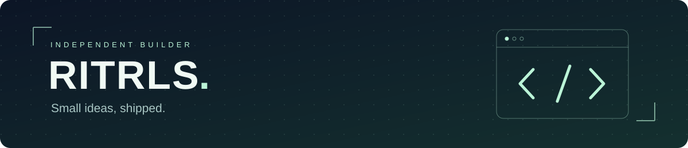
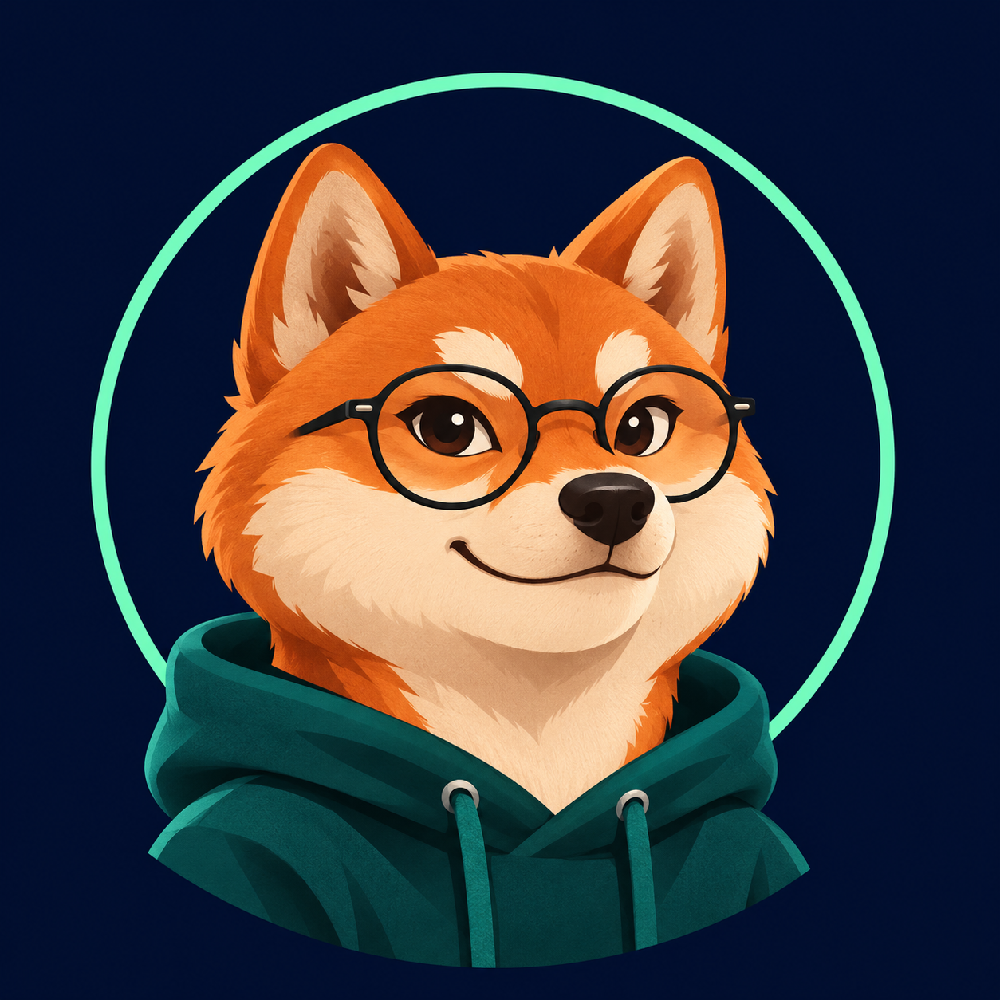

### Ritrls · 独立开发者

**把脑洞写成代码，把原型做成可以点开的作品。**

AI 应用 · 网页游戏 · 开源小工具

[试玩我的项目](https://ritrls.github.io/dream-arcade-demo/) · [查看源码](https://github.com/Ritrls/dream-arcade-demo) · [商务合作](https://github.com/Ritrls/Ritrls/issues/new?template=collaboration.yml)

---

### 正在打磨：造梦街机

一句话创造队员，生成形象、属性与技能，然后直接带进游戏。

| 玩法 | 可以做什么 |
| --- | --- |
| 庭院守卫 | 五路布阵，搭配远程、减速与护盾，抵御五波来客 |
| 口袋战场 | 招募小队、占据据点、集结攻城 |
| 增量矿场 | 雇佣自建单位、安排换班、升级工具、积累离线收益 |

**RunningHub 接入 · 自然语言造单位 · 手机与电脑游玩 · 离线导出**

→ [现在开玩](https://ritrls.github.io/dream-arcade-demo/)　[项目说明与源码](https://github.com/Ritrls/dream-arcade-demo)

### 我在折腾什么

- **AI × 互动玩法**：让生成结果真正进入游戏规则。
- **小而完整的网页产品**：打开链接就能体验，反馈清楚，细节耐用。
- **能复用的实现**：JavaScript、Canvas、Node.js 和 AI API 集成。

### 商务合作

**AI 应用原型 / 网页互动玩法 / RunningHub 集成**

欢迎聊清楚目标、时间和交付范围，再一起把想法做出来。

**商务合作联系：[GitHub 合作入口](https://github.com/Ritrls/Ritrls/issues/new?template=collaboration.yml)。**

代码问题请在对应项目提交 Issue；合作需求请使用上面的入口。公开讨论区请勿填写密钥或其他敏感信息。

---

小项目，也认真打磨。 / Build something people can actually try.

